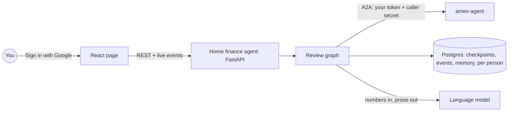

# home-finance-agent

[](https://github.com/erancha/home-finance-agent/actions/workflows/ci.yml)

The home finance agent reviews a household's monthly card spending. It asks each card's service,
over the open [A2A (Agent2Agent) protocol](https://a2a-protocol.org), for the month's charges,
adds them up against a budget, asks you only what it cannot decide, and writes a short summary.
This demo has one card service, [amex-agent](https://github.com/erancha/amex-agent), for an
American Express card. You sign in to both with your Google account; each person sees only their
own reviews and statements.

A2A calls every party in the conversation an agent, and these docs follow its naming (card agent,
home finance agent). The review itself follows a fixed plan written in code, with you in the loop
for what it cannot decide; a language model writes only the summary.

**Contents:** [Boundaries](#boundaries) · [How a review runs](#how-a-review-runs) ·
[Getting started](#getting-started) · [Sign-in](#sign-in) · [Scripts](#scripts) ·
[Testing](#testing) · [Architecture](#architecture) · [License](#license)

## Boundaries

- **The contract is shared, not per agent.** Every card agent offers the same A2A skill,
  `monthly-transactions`: a billing month in, rows out in one format (ISO dates, amounts in
  shekels, one category from a closed list), or a request for the missing statement. amex-agent's
  [contract](https://github.com/erancha/amex-agent/blob/main/docs/a2a-contract.md) specifies it;
  [docs/a2a-contract.md](docs/a2a-contract.md) lists what this agent relies on.
- **Each card agent normalizes and categorizes its own card.** Statement formats, card-specific
  labels, installments and foreign purchases never reach the home finance agent. Rows arrive in
  the shared format, each placed in a category by the card agent with its confidence, `high`,
  `medium` or `low`, or `uncategorized` when it cannot tell.
- **The home finance agent normalizes nothing card-specific.** Adding a card means running its
  agent and connecting it with `add-card-agent.sh`, with no code change here. This agent owns what
  spans cards: your categories, which outrank any card agent's, the budget, the totals and the
  summary.

## How a review runs

1. You sign in with Google, pick a billing month, the month the card is charged (this month by
   default), and press start. The page shows every step live.
2. The home finance agent reads each card agent's Agent Card, checks it offers the skill, and asks
   for the month on your behalf, forwarding your sign-in. Charges stream in as the card agent
   reads them.
3. The review pauses on a question when it needs you: a merchant a card agent is unsure of, or a
   card agent's request for a statement that is not downloaded yet. It waits as long as it
   takes, even across a restart.
4. Your answers resume the review. A merchant question lists its charges, and you answer only the
   ones you recognize. A category you choose is remembered for that merchant, so next month asks
   less. A missing statement links to the card agent's statements page: sign in there with the
   same Google account, load the file and choose "continue", and the card agent's paused task
   resumes.
5. Totals per category are compared to the budget. A language model turns the numbers into a few
   sentences; the numbers themselves never come from it.
6. On the finished review, choosing a category in the spending pie, or the standing orders, lists
   just those charges, and changing a merchant's category redoes the totals and the summary.

## Getting started

Requires **Docker**, **Python 3.12+** and **Node.js 22+**. Everything here is this repo's own; a
card agent is deployed from its own repo and connected at the end.

1. **A Google OAuth client** in a Google Cloud project of its own, with `http://localhost:8010` as
   the authorized JavaScript origin. [docs/sign-in.md](docs/sign-in.md#setting-up-google) walks
   through the console. Add every household member's Google account as a test user: Google signs
   in nobody else while an app is in testing.
2. **A language model key**, Anthropic or OpenAI. `backend/.env` names the model as
   `LLM_MODEL=provider:model`, OpenAI's `gpt-5-nano` unless changed; set that provider's
   key.
3. **The env file, then start:**

   ```bash
   ./scripts/init-env.sh   # writes backend/.env: set GOOGLE_CLIENT_ID and ANTHROPIC_API_KEY in it
   ./scripts/start.sh      # database, migrations and the agent, in Docker
   ```

   Every key is explained in [backend/.env.example](backend/.env.example).
4. Open **http://localhost:8010** and sign in with Google. The page says no card agent is connected
   yet, which is right: this agent runs on its own.
5. **Connect a card agent.** Its operator deploys it from its own repo and registers this agent
   as a caller by name and Google client id, which issues a secret. A card agent's start script
   ends by printing the rest: the name to register it under, the URL this agent calls it at and the
   URL your browser opens its pages at. Pass the four values on:

   ```bash
   ./scripts/add-card-agent.sh --name <name> --url <url> --browser-url <browser url> \
     --secret <the issued secret>
   ./scripts/start.sh      # the agent reads the registry at startup
   ```

   The page then names the agent and offers a review. The whole exchange, both sessions in order
   and what the page says when the card agent is down, is in
   [docs/connecting-agents.md](docs/connecting-agents.md).

## Sign-in

Each agent has its own Google OAuth client, in its own Google Cloud project, and verifies every
token itself against Google's published keys. The home finance agent forwards your token on each
A2A call together with the secret the card agent issued to it, so the card agent knows both who is
asking and on whose behalf. Setting up the two clients takes a few minutes in the Google Cloud
console: [docs/sign-in.md](docs/sign-in.md) walks through it and explains the design, including
what a card agent run by someone else would do differently. Sign-in works on `localhost` or a
public hostname only, which is what Google allows as an origin; a phone on the home network cannot
sign in until the stack is reached through a hostname.

## Scripts

All live in `scripts/`; run with `--help` for full usage.

| Script | Purpose |
|---|---|
| `init-env.sh` | Create `backend/.env` and an empty card-agent registry; `--force` overwrites the env file. |
| `add-card-agent.sh` | Connect a card agent, or replace its entry, in `backend/card-agents.yaml`. |
| `start.sh` | Run database, migrations and the agent in Docker, or `--host` with the agent as a local process (the page is rebuilt when its sources changed). |
| `docker-helper.sh` | Stop, follow logs, or show status of the Docker stack. |
| `sql-helper.sh` | Row counts of every database table (`--counts`), or their contents (`--rows`). |
| `test.sh` | Backend and frontend checks; `e2e` runs whole reviews through both agents. |

## Testing

```bash
./scripts/test.sh          # backend (lint, types, import boundaries, tests) + frontend
./scripts/test.sh e2e      # both agents in Docker, one full review with its questions answered
```
The layers and what each proves: [docs/testing.md](docs/testing.md).

## Architecture



The review is a small state machine that can pause and resume; its state lives in Postgres, so a
question can wait for hours. The home finance agent is the A2A client; each card agent is opaque to
it beyond the protocol. Details and the reasoning behind them:
[docs/architecture.md](docs/architecture.md); what it relies on from card agents:
[docs/a2a-contract.md](docs/a2a-contract.md); how sign-in spans the agents:
[docs/sign-in.md](docs/sign-in.md).

**Stack:** Python, FastAPI, LangGraph, Postgres, a2a-sdk, React, Docker.

## License

Released under the MIT License. See [LICENSE](LICENSE).

---
More projects by the author: [github.com/erancha](https://github.com/erancha)
