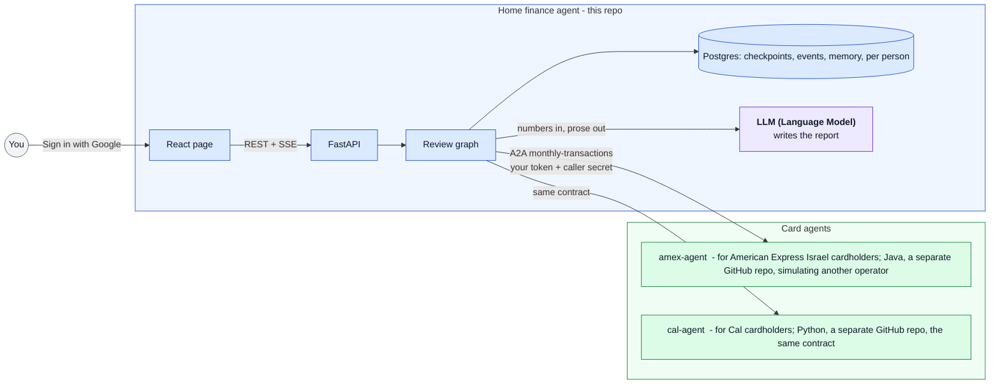

# home-finance-agent

[](https://github.com/erancha/home-finance-agent/actions/workflows/ci.yml)

The home finance agent is a multi-user, scalable AI agent that reviews a household member's monthly
card spending. It asks each card's service, over the open
[A2A (Agent2Agent) protocol](https://a2a-protocol.org), for the month's charges, adds them up
against a budget, asks you only what it cannot decide, and writes a short summary.
[amex-agent](https://github.com/erancha/amex-agent), for an American Express card, and
[cal-agent](https://github.com/erancha/cal-agent), for a Cal card, are the demo's card agents, one
in Java and one in Python; any card agent offering the same contract connects the same way. You
sign in to each with your Google account; each person sees only their own reviews and statements.

A2A calls every party in the conversation an agent, and these docs follow its naming (card agent,
home finance agent). The review itself follows a fixed plan written in code, with you in the loop
for what it cannot decide; a language model writes only the summary. In fairness, a card agent is
closer to a service than to an agent, and much of the exchange would fit plain HTTP streaming;
[docs/why-a2a.md](docs/why-a2a.md) says what the protocol does and does not add here.

**Contents:** [Architecture](#architecture) · [How a review runs](#how-a-review-runs) ·
[Boundaries](#boundaries) · [Getting started](#getting-started) · [Scripts](#scripts) ·
[Testing](#testing) · [License](#license)

## Architecture



A review of one month runs in the Review graph box above: a small state machine that pauses when
it has a question for you and resumes with your answer. Its state lives in Postgres, so a question
waits as long as it takes, across restarts. The home finance agent is the A2A client of one card
agent per card issuer, all offering the same contract, and each card agent is opaque to it beyond
that contract. Details and the reasoning behind them:
[docs/architecture.md](docs/architecture.md); the contract every card agent offers:
[docs/a2a-contract.md](docs/a2a-contract.md); how sign-in spans the agents:
[docs/sign-in.md](docs/sign-in.md).

**Stack:** Python, FastAPI, LangGraph, Postgres, a2a-sdk, React, Docker.

## How a review runs

1. You sign in with Google, pick a billing month, the month the card is charged (this month by
   default), and press start. The page shows every step live.
2. The home finance agent reads each card agent's Agent Card, checks it offers the skill, and asks
   for the month on your behalf, forwarding your sign-in. Charges stream in as the card agent
   reads them.
3. The review pauses on a question when it needs you: a card agent's request for a statement that is
   not downloaded yet, or a merchant a card agent is unsure of. It waits as long as it takes, even
   across a restart.
4. Your answers resume the review. A merchant question lists its charges, and you answer only the
   ones you recognize. A category you choose is remembered for that merchant, so next month asks
   less. A missing statement links to the card agent's statements page: sign in there with the
   same Google account, load the file and press "continue", and the card agent's paused task
   resumes.
5. Totals per category are compared to the budget. A language model turns the numbers into a few
   sentences; the numbers themselves never come from it.
6. On the finished review, choosing a category in the spending pie, or the standing orders, lists
   just those charges, and changing a merchant's category redoes the totals and the summary.
7. Mid-month, "Include expected charges" adds the standing orders and installments the latest
   earlier reviewed month says are still to come, so the pie shows where the month is heading.

## Boundaries

- **Each card agent normalizes and categorizes its own card, so the home finance agent handles
  nothing card-specific.** Statement formats, card-specific labels, installments and foreign
  purchases never reach it. Rows arrive in one shared format, each placed in a category by the
  card agent with its confidence, `high`, `medium` or `low`, or `uncategorized` when it cannot
  tell. Adding a card means running its agent and connecting it with `add-card-agent.sh`, with no
  code change here. This agent owns only what spans cards: your categories (which outrank any card
  agent's), the budget, the totals and the summary.
- **They meet at one A2A contract, the same for every card agent.** The skill
  `monthly-transactions` takes a billing month and returns rows in that shared format (ISO dates,
  amounts in shekels, one category from a closed list), or a request for the missing statement.
  [docs/a2a-contract.md](docs/a2a-contract.md) is the contract; a card agent documents how it
  implements it in its own repo.

## Getting started

Requires **Docker**, **Python 3.12+** and **Node.js 22+**. Everything here is this repo's own; a
card agent is deployed from its own repo and connected at the end.

1. **The env file and the budget.** `./scripts/init-env.sh` writes `backend/.env`; every key in it
   is explained in [backend/.env.example](backend/.env.example). The next two steps fill in the two
   it needs. It also writes `config/budget.yaml`, your monthly limit per category, from the
   committed example; the file is yours and stays out of git.
2. **A Google OAuth client** in a Google Cloud project of its own, with `http://localhost:8010` as
   the authorized JavaScript origin. [docs/sign-in.md](docs/sign-in.md#setting-up-google) walks
   through the console. Add every household member's Google account as a test user: Google signs in
   nobody else while an app is in testing. The client id goes into `backend/.env` as
   `GOOGLE_CLIENT_ID`. Google allows only `localhost` or a public hostname as an origin, so a phone
   on the home network cannot sign in until the stack is reached through a hostname.
3. **A language model key**, Anthropic or OpenAI, as `LLM_API_KEY`. `LLM_MODEL=provider:model`
   names the model, OpenAI's `gpt-5-nano` unless changed.
4. **Start:**

   ```bash
   ./scripts/start.sh      # database, Redis, migrations and the agent's replicas, in Docker
   ```

   Once the agent is up, the script ends by printing this agent's Google client id:

   ```text
   Hand this to each card agent's operator, who registers this agent as a caller with it:
     Google client id: <the GOOGLE_CLIENT_ID from backend/.env>
   ```

   That id is public. Send it to the card agent's operator; step 6 records what they send back.
5. Open **http://localhost:8010** and sign in with Google. The page says no card agent is connected
   yet, which is right: this agent runs on its own.
6. **Connect a card agent.** Both operators' sides, in order, are in
   [docs/connecting-agents.md](docs/connecting-agents.md). The card agent's operator deploys it
   from its own repo and registers this agent as a caller with the client id from step 4. The
   registration prints four values, which they send you by whatever channel you two share, a
   message or a password manager; nothing in either agent transmits them. Each goes into one flag
   of the command below:

   | Value | Flag |
   |---|---|
   | the card agent's name | `--name` |
   | the URL this agent calls it at | `--url` |
   | the URL your browser opens its pages at | `--browser-url` |
   | the secret, shown once and confidential | `--secret` |

   ```bash
   ./scripts/add-card-agent.sh --name <name> --url <url> --browser-url <browser url> \
     --secret <secret>
   ./scripts/start.sh      # the agent reads the registry at startup
   ```

   The page then names the agent and offers a review.

## Scripts

All live in `scripts/`; run with `--help` for full usage.

| Script | Purpose |
|---|---|
| `init-env.sh` | Create `backend/.env`, an empty card-agent registry and `config/budget.yaml` from its example; `--force` overwrites the env file only. |
| `add-card-agent.sh` | Connect a card agent, or replace its entry, in `backend/card-agents.yaml`. |
| `start.sh` | Run database, Redis, migrations and the agent's replicas behind an nginx edge in Docker, or `--host` with the agent as a local process (the page is rebuilt when its sources changed); prints the Google client id a card agent registers this agent with. |
| `docker-helper.sh` | Stop, follow logs, or show status of the Docker stack. |
| `sql-helper.sh` | Row counts of every database table (`--counts`), or their first 20 rows (`--rows`, `--limit N` for more). |
| `test.sh` | Backend and frontend checks; `e2e` runs whole reviews through both agents. |

## Testing

```bash
./scripts/test.sh          # backend (lint, types, import boundaries, tests) + frontend
./scripts/test.sh e2e      # both agents in Docker, one full review with its questions answered
```
The layers and what each proves: [docs/testing.md](docs/testing.md).

## License

Released under the MIT License. See [LICENSE](LICENSE).

---
More projects by the author: [github.com/erancha](https://github.com/erancha)
