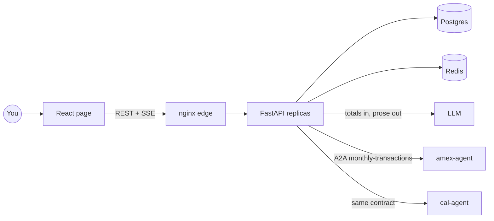

# home-finance-agent

The home finance agent is a multi-user, scalable AI agent that reviews a household member's
monthly card spending, in shekels. Each card has a card agent, a separate service that reads the
card's monthly statement file, which you load on that service's own page, and places
every charge in a category. The home finance agent asks each card agent, over the open
[A2A (Agent2Agent) protocol](https://a2a-protocol.org), for the month's charges, adds them up
against a budget, asks you only what it cannot decide, and writes a short summary.
[amex-agent](https://github.com/erancha/amex-agent), for an American Express Israel card, and
[cal-agent](https://github.com/erancha/cal-agent), for a Cal card, are the demo's card agents, one
in Java and one in Python, each deployed from its own repo by its own operator; any card agent
offering the same contract connects the same way. A2A calls every party in the conversation an
agent, and these docs follow its naming; the review itself follows a fixed plan written in code,
and a language model writes only the summary.

**Contents:** [Overview](#overview) · [Tech stack](#tech-stack) · [Architecture](#architecture) ·
[Getting started](#getting-started) · [Scripts](#scripts) · [Details](#details) ·
[License](#license)

## Overview

- You sign in with your Google account, to this agent and to each card agent; each person sees
  only their own reviews and statements.
- You pick a billing month, the month the card is charged (this month by default), and press
  start. The page shows every step live as each card agent's charges stream in.
- The review pauses on a question when it needs you: a statement that is not loaded yet, or a
  merchant a card agent is unsure of. It waits as long as it takes, even across a restart.
- A merchant question lists its charges, and you answer only the ones you recognize. A category
  you choose is remembered for that merchant, so next month asks less.
- A missing statement links to the card agent's statements page: sign in there with the same
  Google account, load the file and press "continue", and the review goes on.
- Totals per category are compared to your budget, and a language model turns the numbers into a
  few sentences; the numbers themselves never come from it.
- On a finished review, choosing a category in the spending pie, or the standing orders, lists
  just those charges, and changing a merchant's category redoes the totals and the summary.
- Mid-month, "Include expected charges" adds the standing orders and installments that your most
  recent earlier review says are still to come, so the pie shows where the month is heading.

## Tech stack

- **Backend** — Python, FastAPI on uvicorn, LangGraph for the review's state machine
- **A2A** — the official `a2a-sdk` client, streaming each card agent's month
- **Model** — Anthropic or OpenAI through LangChain, chosen by one setting, to write the summary
- **Storage** — Postgres 16 through SQLAlchemy and Alembic: reviews, their events, LangGraph's
  checkpoints and the per-person memories; Redis carries live events between the replicas
- **Frontend** — React and TypeScript built with Vite, charts with Recharts
- **Auth** — Google sign-in; the backend checks the ID token with PyJWT and forwards it
- **Runtime** — Docker Compose: two backend replicas behind an nginx edge, on a workstation or
  on a shared EC2 instance behind CloudFront
- **Tests** — pytest with Testcontainers, ruff, mypy and import-linter; Vitest with Testing
  Library; an end-to-end review through amex-agent; GitHub Actions runs the gate

## Architecture

The page talks to the backend replicas over REST and a live event stream, through an nginx edge;
Redis carries each review's live events to whichever replica serves the stream. A review of one
month runs in a review graph, a small state machine that pauses when it has a question for you
and resumes with your answer; its state lives in Postgres, so a question waits across restarts.
The backend is the A2A client of one card agent per card issuer, each opaque to it beyond the
shared contract, and forwards your Google sign-in on every call.

**[Architecture](docs/architecture.md)** continues from here: the full diagram, the Compose
services, the boundaries between this agent and the card agents, and a section per subsystem.

## Getting started

Needs Docker; the tests also need Python 3.12+ and Node.js 22. A review needs a running card
agent, deployed from its own repo, though this agent starts and signs you in without one.

1. Create a Google OAuth web client in a Google Cloud project of your own, with
   `http://localhost:8010` as its authorized JavaScript origin, and add your household's Google
   accounts as test users ([Sign-in](docs/sign-in.md#setting-up-google) walks the console).
2. Run `./scripts/deploy.sh`. The first run creates the gitignored settings files under
   `scripts/lib/` from their `.example.sh` files, which explain each setting, with a generated
   database password, plus an empty card-agent registry (`backend/card-agents.yaml`) and
   `config/budget.yaml`, then stops and names each setting left to fill in: `LLM_MODEL` as
   `provider:model` (`anthropic` or `openai`) and the client id as `GOOGLE_CLIENT_ID` in
   `params.sh`, and that provider's `LLM_API_KEY` in `secrets.sh`.
3. Fill them in, put your monthly limit per category in `config/budget.yaml`, and run
   `./scripts/deploy.sh` again. It builds the images, starts the stack, returns once the page
   answers, and prints this agent's Google client id. Hand it to the operator of each card
   agent: their registration script records this agent as a caller and issues it a secret.
4. Open http://localhost:8010 and sign in; the page says no card agent is connected yet.
5. Connect a card agent with the four values its operator sends back, its name, the URL this
   agent calls, the URL your browser opens its pages at and the secret:
   `./scripts/tools/add-card-agent.sh --name <name> --url <url> --browser-url <url> --secret
   <secret>`, then run `./scripts/deploy.sh` again, since the registry is read at startup.
6. To run the stack on AWS instead, on an EC2 instance behind a CloudFront distribution of its
   own, run `./scripts/deploy.sh --ec2`: on an instance of its own, or as a guest on another
   Docker Compose repo's instance when `EC2_HOST_STACK` of `params.sh` names that repo's stack. It
   also names the access key pair and region to fill in in `aws-config.sh`, and at the end
   prints the CloudFront address to add to the Google client. The instance's card agents go into
   their own registry with `tools/add-card-agent.sh --ec2`
   ([Development & deployment](docs/development.md#connecting-a-card-agent)).

`./scripts/test.sh` runs the backend and frontend checks; none needs a model key.
[Development & deployment](docs/development.md) has the addresses, the tests and the scripts.

## Scripts

- `init-env.sh` — creates the gitignored settings files under `scripts/lib/`, with a generated
  database password, the empty card-agent registries and the budget; `deploy.sh` runs it first
- `test.sh` — the backend and frontend checks; `e2e` runs a whole review through this agent and
  amex-agent
- `deploy.sh` — builds and starts Postgres, Redis, the backend replicas and the edge in Docker;
  `--ec2` does it on the shared EC2 instance behind CloudFront
- `docker-helper.sh` — stops the stack, follows its logs or shows its status

Each script's header comment is its full documentation, and `--help` prints it. Hands-on tools,
such as connecting a card agent, are in [scripts/tools/](scripts/tools/README.md).

## Details

- [Architecture](docs/architecture.md) — the Compose services, the boundaries with the card
  agents, the subsystems, the edge on EC2, storage and the codebase
- [API endpoints](docs/api.md) — every route of the backend, who may call it and what it answers
- [Workers' responsibilities and flows](docs/workers.md) — the review runs and the schema
  migration
- [Reviews](docs/architecture/reviews.md) — the review graph, its steps and why it is shaped so
- [Events and the live stream](docs/architecture/events.md) — the event log, the stream and the
  page that renders from it
- [Scaling](docs/architecture/scaling.md) — what running several replicas requires, and the edge
- [Design patterns](docs/design-patterns.md) — the backend's layers and how they are enforced
- [Data model](docs/data-model.md) — every table, its keys, and the two memories
- [A2A contract](docs/a2a-contract.md) — the `monthly-transactions` skill every card agent offers
- [Connecting agents](docs/connecting-agents.md) — both operators' sessions, in order
- [Why A2A](docs/why-a2a.md) — what the protocol adds here, and what it does not
- [Sign-in](docs/sign-in.md) — how one Google sign-in spans the agents, and the Google setup
- [Development & deployment](docs/development.md) — the settings, the tests, the scripts, the
  EC2 stack and the addresses
- [Testing](docs/testing.md) — what each test layer proves
- [ADRs](docs/adr/) — the founding decisions, one record each, with their reasons

## License

Source-available under the [PolyForm Noncommercial License 1.0.0](LICENSE). Reading the source,
forking it and running a private deployment are free for anyone, companies included —
[NOTICE](NOTICE) grants that explicitly for evaluating the project or its author. Building a
commercial product or service on it needs a commercial license: erancha@gmail.com.

---
More projects by the author: [github.com/erancha](https://github.com/erancha)
