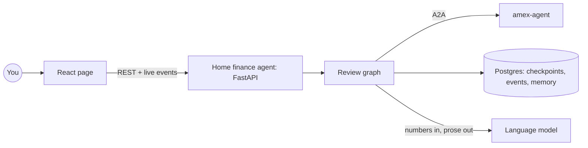

# home-finance-agent

[](https://github.com/erancha/home-finance-agent/actions/workflows/ci.yml)

The home finance agent reviews a household's monthly card spending. It asks each card's service,
over the open [A2A (Agent2Agent) protocol](https://a2a-protocol.org), for the month's charges,
adds them up against a budget, asks you only what it cannot decide, and writes a short summary.
This demo has one card service, [amex-agent](https://github.com/erancha/amex-agent), for an
American Express card.

A2A calls every party in the conversation an agent, and these docs follow its naming (card agent,
home finance agent). The review itself follows a fixed plan written in code, with you in the loop
for what it cannot decide; a language model writes only the summary.

**Contents:** [Boundaries](#boundaries) · [How a review runs](#how-a-review-runs) ·
[Getting started](#getting-started) · [Scripts](#scripts) · [Testing](#testing) ·
[Architecture](#architecture) · [License](#license)

## Boundaries

- **The contract is shared, not per agent.** Every card agent offers the same A2A skill,
  `monthly-transactions`: a billing month in, rows out in one format (ISO dates, amounts in
  shekels, one category from a closed list), or a request for the missing statement. amex-agent's
  [contract](https://github.com/erancha/amex-agent/blob/main/docs/a2a-contract.md) specifies it;
  [docs/a2a-contract.md](docs/a2a-contract.md) lists what this agent relies on.
- **Each card agent normalizes and categorizes its own card.** Statement formats, card-specific
  labels, installments and foreign purchases never reach the home finance agent. Rows arrive in
  the shared format, each placed in a category by the card agent with its confidence, `high`,
  `medium` or `low`, or `uncategorized` when it cannot tell.
- **The home finance agent normalizes nothing card-specific.** Adding a card means running its
  agent and listing it in `config/agents.yaml`, with no code change here. This agent owns what
  spans cards: your categories, which outrank any card agent's, the budget, the totals and the
  summary.

## How a review runs

1. You pick a billing month, the month the card is charged (this month by default), and press
   start. The page shows every step live.
2. The home finance agent reads each card agent's Agent Card, checks it offers the skill, and asks
   for the month. Charges stream in as the card agent reads them.
3. The review pauses on a question when it needs you: a merchant a card agent is unsure of, or a
   card agent's request for a statement that is not downloaded yet. It waits as long as it
   takes, even across a restart.
4. Your answers resume the review. A merchant question lists its charges, and you answer only the
   ones you recognize. A category you choose is remembered for that merchant, so next month asks
   less. A missing statement links to the card agent's statements page: load the file there and
   choose "continue", and the card agent's paused task resumes.
5. Totals per category are compared to the budget. A language model turns the numbers into a few
   sentences; the numbers themselves never come from it.
6. On the finished review, choosing a category in the spending pie, or the standing orders, lists
   just those charges, and changing a merchant's category redoes the totals and the summary.

## Getting started

Requires **Docker**, **Python 3.12+** and **Node.js 22+**, and the amex-agent repo checked out
beside this one (`backend/.env` names it and its `statements/` folder). `start.sh --host` also
needs Java 21 and Maven for amex-agent.

```bash
./scripts/init-env.sh      # writes backend/.env and shares one access token with amex-agent
./scripts/start.sh         # database, both agents and the page, in Docker
```

Open **http://localhost:8010**. From a phone or another computer on the same network, open
`http://<this machine's address>:8010` instead
([details](docs/architecture.md#other-devices-on-your-network)). amex-agent describes itself at
**http://localhost:8020/.well-known/agent-card.json**.

Both agents use a language model: amex-agent to categorize each purchase, this agent to write the
summary at the end of a review. Neither starts without a provider and its API key: set `LLM_MODEL`
(e.g. `anthropic:claude-haiku-5-5`) and the provider's key in `backend/.env`, and the model and key
in amex-agent's `.env`; every key here is explained in [backend/.env.example](backend/.env.example).

## Scripts

All live in `scripts/`; run with `--help` for full usage.

| Script | Purpose |
|---|---|
| `init-env.sh` | Create `backend/.env` and share the access token with amex-agent. |
| `start.sh` | Run everything in Docker, or `--host` as local processes (the page is rebuilt when its sources changed). |
| `docker-helper.sh` | Stop, follow logs, or show status of the Docker stack. |
| `sql-helper.sh` | Row counts of every database table (`--counts`), or their contents (`--rows`). |
| `test.sh` | Backend and frontend checks; `e2e` runs whole reviews through both agents. |

## Testing

```bash
./scripts/test.sh          # backend (lint, types, import boundaries, tests) + frontend
./scripts/test.sh e2e      # both agents in Docker, one full review with its questions answered
```
The layers and what each proves: [docs/testing.md](docs/testing.md).

## Architecture



The review is a small state machine that can pause and resume; its state lives in Postgres, so a
question can wait for hours. The home finance agent is the A2A client; each card agent is opaque to
it beyond the protocol. Details and the reasoning behind them:
[docs/architecture.md](docs/architecture.md); what it relies on from card agents:
[docs/a2a-contract.md](docs/a2a-contract.md).

**Stack:** Python, FastAPI, LangGraph, Postgres, a2a-sdk, React, Docker.

## License

Released under the MIT License. See [LICENSE](LICENSE).

---
More projects by the author: [github.com/erancha](https://github.com/erancha)
