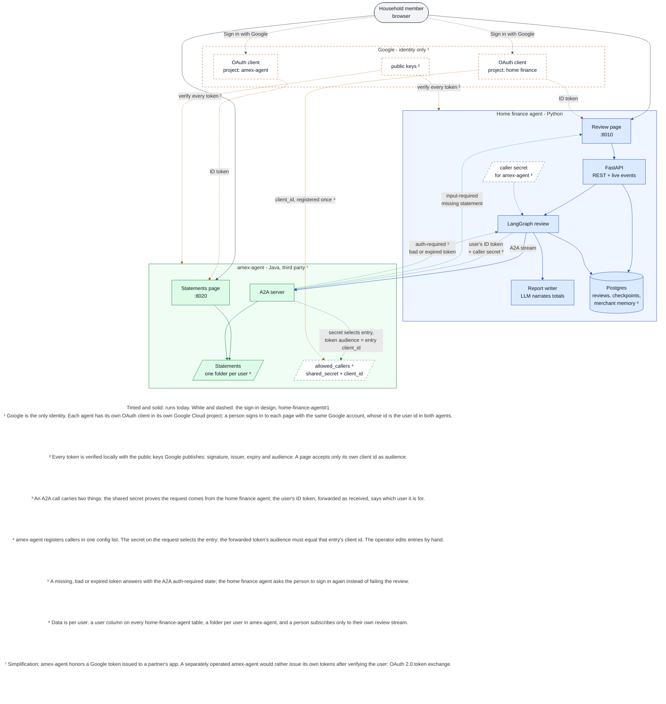

# Sign-in across the two agents

The design for per-user sign-in and data isolation, tracked in
[#1](https://github.com/erancha/home-finance-agent/issues/1) and mirrored in
[amex-agent#4](https://github.com/erancha/amex-agent/issues/4). Nothing here is built yet. Today
both web pages are open, all data belongs to one household, and the only credential is the shared
secret the home finance agent sends on every A2A call (`AMEX_AGENT_TOKEN`, amex-agent's
`APP_A2A_TOKEN`; see [a2a-contract.md](a2a-contract.md)).

In the diagram, tinted shapes and solid arrows run today; white shapes and dashed arrows are the
design. Colors mark who owns a component and who sends an arrow: blue for the home finance agent,
green for amex-agent, amber for Google, grey for the person at the browser.



## The design in six points

**Google is the only identity.** Each agent will have its own OAuth client in its own Google Cloud
project, so the two share nothing by default; two projects under one Google account stand in for
two operators. A person will sign in to each page with the same Google account and nothing else.
The stable Google account id will be the user id in both agents. No registration step, no stored
passwords.

**Every token is verified locally, the same way everywhere.** Both agents will cache the public
keys Google publishes and check each token's signature, issuer, expiry and audience. The audience
names the client the token was issued to; a page will accept only its own client id.

**An A2A call will carry two things.** The shared secret, which stays as it is today, will prove
the request comes from the home finance agent. The signed-in person's Google ID token, forwarded
as received, will say which user the call is for, and amex-agent will verify it itself rather than
trust a bare user id.

**amex-agent will register callers in config, not in a database.** One entry per caller:

```yaml
allowed_callers:
  - name: home-finance-agent
    shared_secret: <random>
    client_id: <the home finance agent's Google client id>
```

The secret on a request selects the entry, compared in constant time; the forwarded token's
audience must equal that entry's client id. Registration is the amex-agent operator adding an
entry, and removing it revokes the caller. Only the secret is confidential; the client id is
public. For the demo, `init-env.sh` will write the single entry the way it syncs the token today.
The agent card will advertise the scheme.

**A missing, bad or expired token** will be answered with the A2A auth-required task state. The
home finance agent will treat it as one more stream state and ask the person to sign in again,
rather than failing the review.

**Data will be keyed by user.** In the home finance agent: reviews, review events, checkpoints,
merchant memory, and the live event stream, where a person may subscribe only to their own review.
In amex-agent: a statements folder per Google id, a statements page that lists only the signed-in
person's files, and a missing-statement link that lands the same person there.

## The stated simplification

amex-agent will honor a Google token that was issued to a partner's app. That is what two services
trusting the same identity provider do under one roof. A genuinely separate operator would more
likely issue its own access tokens after verifying the person, through OAuth 2.0 token exchange
(RFC 8693), and would advertise an OAuth 2.0 scheme of its own in the agent card. Everything else
above would stay as it is.
