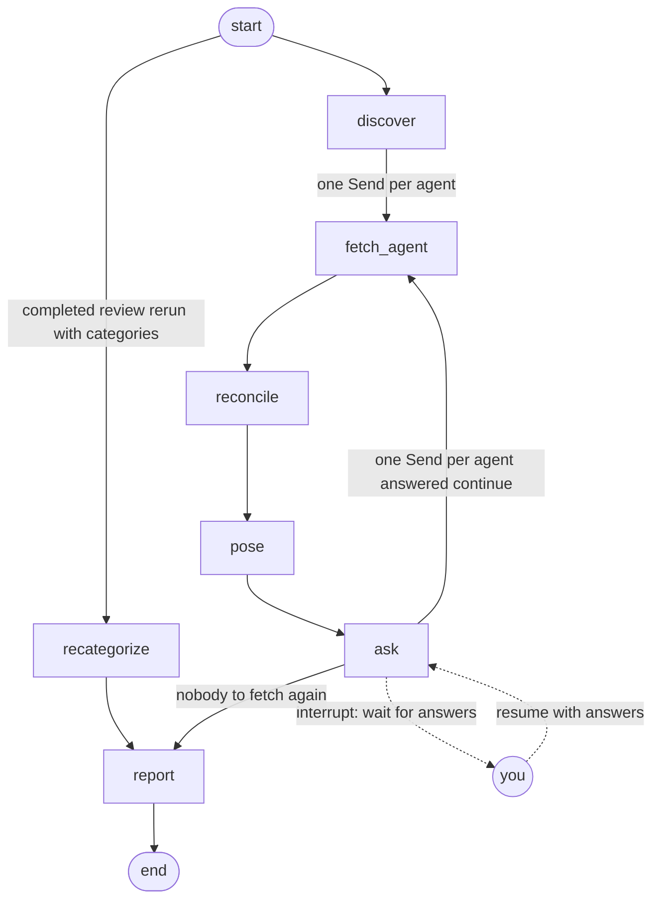

# Architecture

How the home finance agent is built, and why. The message contract with amex-agent is in
[a2a-contract.md](a2a-contract.md); how each part is tested is in [testing.md](testing.md).

**Contents:** [Layers](#layers) · [The review graph](#the-review-graph) ·
[Running a review](#running-a-review) · [Events and the live stream](#events-and-the-live-stream) ·
[Storage](#storage) · [Configuration](#configuration) · [Report providers](#report-providers)

## Layers

One package, `hfm`, under `backend/src`, in five layers:

| Layer | Holds | Modules |
|---|---|---|
| `domain` | Plain immutable values and the rules on them: transactions, budget, totals, questions, events, the category list, merchant keys, errors. | `models`, `taxonomy`, `merchants`, `questions`, `events`, `errors` |
| `ports` | The interfaces the review needs from the outside world, as Python protocols. | `card_agent`, `repositories`, `events`, `report` |
| `application` | The review itself: the graph, totals arithmetic, questions and answer checks, the report prompt, the event sink. | `review_graph`, `reconcile`, `questions`, `report`, `event_sink` |
| `adapters` | Port implementations: the A2A client, Postgres repositories, the report writers, YAML config loading, the in-process event bus. | `a2a_client`, `postgres/`, `report_writer`, `config_files`, `memory_bus` |
| `platform` | The running process: settings, logging, database engine, checkpointer, the review runner and the HTTP API. | `config`, `logging`, `db`, `checkpointer`, `review_runner`, `app`, `dependencies`, `api/` |

Imports point inwards only. `platform` may use everything; `application` uses `ports` and
`domain`; `ports` uses `domain`; `adapters` use `ports` and `domain` and never `application` or
`platform`. `domain`, `ports` and `application` import no framework: no a2a-sdk, FastAPI,
Starlette, SQLAlchemy, psycopg, LangChain, httpx, PyYAML or structlog. The one exception is
LangGraph, which only `application.review_graph` may import, because the graph is the review's
orchestration.

These rules are four import-linter contracts in `backend/pyproject.toml`. `lint-imports` checks
them in `scripts/test.sh backend`, and `tests/test_architecture.py` runs it again inside pytest.

## The review graph

`application/review_graph.py` builds the review as a LangGraph state machine whose state is saved
after every step. The review id is the saved state's thread id, so one id names both the review
row and its graph.

Two loops run through it. The human loop pauses at `ask` until answers arrive, for as long as it
takes. The fetch loop goes back to `fetch_agent` for every agent whose question was answered
"continue", and the review runs `reconcile`, `pose` and `ask` again on the new rows. A completed
review can be run again on the same thread with categories chosen for its merchants: that run
starts at `recategorize` instead of `discover`, so nothing is fetched again.

| Node | Does |
|---|---|
| `discover` | Reads each configured agent's card and checks it is usable; emits `agent.discovered`. An unusable agent fails the review. |
| `fetch_agent` | Streams one agent's month (or continues its waiting task) with `SendStreamingMessage`; emits `agent.status` and `transactions.batch`; records the task and any request for input. |
| `reconcile` | Applies merchant memory, which outranks the card agent's category, computes totals, emits `review.totals`. |
| `pose` | Builds the questions (one per merchant with an uncategorized or `low`-confidence row, not left unanswered earlier, one per agent waiting for input), emits `review.question` and stores the questions. |
| `ask` | Calls `interrupt()` with the stored questions; on resume checks the answers, remembers the chosen categories, marks unanswered merchants and skipped agents, and emits `review.totals` again when something changed. |
| `recategorize` | Remembers the categories chosen for merchants of a completed review, applies them to every row of each merchant, and emits `review.totals`. |
| `report` | Builds the prompt from the computed totals and emits `review.report` with the model's text. |

**Reducers.** Parallel fetches write to the same state keys, so each such key has a merge rule:

- `transactions` (`merge_transactions`): one row per (agent, transaction id), the later copy
  winning, first-seen order kept, so rows resent after a "continue" are counted once.
- `infos`, `tasks`, `pending_remote`, `skipped` (`merge_dict`): per-agent entries merged, and a
  `None` value removes the agent's entry, which is how an answered remote question is cleared.

**Why `Send`.** The number of fetches is data, not graph shape: one per configured agent at the
start, then one per agent answered "continue", each carrying its own agent, month and the task to
continue. A conditional edge returning a list of `Send` runs exactly those fetches in parallel,
each with its own input, and the reducers merge their results.

**Why `interrupt()` with a Postgres checkpointer.** A paused review holds no process, thread or
connection; it is a saved state in Postgres, built by LangGraph's `AsyncPostgresSaver`. The
answer may come hours later or after a restart, and the runner resumes the same thread with
`Command(resume={"answers": ...})`.

**Why `pose` and `ask` are separate nodes.** On resume LangGraph runs the interrupted node again
from its first line. If one node emitted `review.question` and then interrupted, every resume would
emit the question again. `pose` emits and saves the questions; `ask` only reads them and
interrupts, so rerunning `ask` emits nothing twice.

**What "continue" and "skip" mean.** A remote question comes from an agent whose task is waiting
for input (its statement is not loaded yet). "continue" sends `{"action": "continue"}` on that
same A2A task, so the agent picks the request up where it paused; if the statement is still
missing, the agent asks again. When the agent names a page for the request, the question carries
`link`, that page on the agent's browser address (`AgentConfig.browser_url`), and offers only
"continue": the person loads the statement there and then continues. A question without a page
also offers "skip", which leaves the agent out: the review totals what it has, lists the agent
under `skipped` in `review.totals`, and the report prompt asks the model to say plainly that the
agent's spend is missing. amex-agent always names its statements page, so its questions never
offer "skip".

**Checkpoint types.** `checkpoint_serde()` gives the checkpointer an explicit allow-list of the
domain types that can sit in the state (`CHECKPOINTED_TYPES`). LangGraph rebuilds only those types
and its own safe built-ins from a checkpoint; any other type is not rebuilt, and LangGraph logs a
warning. `LANGGRAPH_STRICT_MSGPACK=true`, which the scripts, compose and the test suite set, puts
LangGraph's default serializers in the same strict mode instead of their permissive default. The
graph tests fail on any checkpoint warning, so a state type missing from the list fails the suite.

**No secret in a checkpoint.** The state and every `Send` name agents only; `discover` records the
configured names when the review starts, and each fetch resolves the name to its URL and token from
the graph's dependencies. A paused review whose agent has left `config/agents.yaml` fails with
"`<name>` is no longer configured" when it resumes.

**Numbers never come from the model.** Totals, limits and the over-budget flag are computed in
`application/reconcile.py` with `Decimal`. The model only receives them as a table in the prompt
(`application/report.py`) and returns prose, which is shown as is.

## Running a review

`platform/review_runner.py` owns the graph invocations. Every invocation runs as a background task,
so the HTTP request that starts or answers a review returns as soon as the review is recorded. A
review has at most one invocation in flight.

| Status | Means |
|---|---|
| `running` | An invocation is in flight. |
| `waiting` | The graph stopped at the `ask` interrupt. |
| `completed` | The graph reached its end. |
| `failed` | The invocation raised; a `review.failed` event carries the message. |

**A restart keeps waiting reviews and fails running ones.** A `waiting` review is only a saved
state, so it can be answered after any restart; a review still `running` when the server starts lost
its invocation with the old process, so startup marks it `failed` with the `review.failed` message
"interrupted by a server restart; clear the review and start it again". The sweep assumes one home
finance agent per database: a second one started against the same database, such as
`start.sh --host` beside the Docker stack, fails the first one's in-flight reviews.

**Starts are rationed.** Every start fetches the month from the card agents, which classify its
merchants with a model, and has a model write the report, so repeating a start costs model calls on
both sides. A month therefore holds one standing review until the person clears it (`DELETE
/api/reviews/{id}`); a start for a month that has one is refused with 409 naming it. The page asks
first (`GET /api/months/{month}`), so it never offers that start: a month with its review shows the
review and offers Clear review, a month without one offers Start review with the starts left. A
running review cannot be cleared, since its invocation would go on writing to it. On top of that, at
most `DAILY_REVIEW_LIMIT` (3) reviews start in any 24 hours (`REVIEW_LIMIT_WINDOW`), cleared ones
included, and a start past it gets 429 with `Retry-After`. A cleared review is kept in the database
with `cleared_at` set, so it still counts, but the API answers 404 for it. A partial unique index on
`reviews.month` where `cleared_at` is null holds the one-standing-review rule in the database too;
the runner checks both rules under the lock that serializes its status changes.

**Answers are checked before the graph resumes.** The runner validates an answer set against the
saved questions first: every remote question answered, no unknown id, every value one of the offered
options. Categorize questions may go unanswered, since a person may not recall every merchant: those
rows keep the card agent's category (`uncategorized` when it had none), nothing is remembered for
them, and the review does not ask about them again, even after a "continue" brings more of their
rows. A bad set gets HTTP 422 with the
`missing`, `unknown` and `invalid` ids, and the review stays paused. The check has to happen here,
not inside the graph: LangGraph keeps the resume value of a failed run and replays it on every later
resume of the thread, so one bad answer set would break the review for good.

**Answers that race the pause.** `pose` emits `review.question` before `ask` saves the pause, so a
quick client can answer while the run is still settling. The runner then waits up to 30 seconds
(`SETTLE_SECONDS`) for the run to stop instead of refusing with 409. The review view
(`GET /api/reviews/{id}`) offers questions only once the run has settled.

**Failures are readable.** A `ReviewError` (an unusable agent, an agent's failed task, a review
with no agents) reaches the user verbatim in `review.failed`. Any other error is reported as
`<Type>: see the server log` and logged with its traceback.

**HTTP API.**

| Route | Answer |
|---|---|
| `POST /api/reviews` `{"month": "YYYY-MM"}` | 202 `{"id": ...}`; 409 with `detail` `{"message", "reviewId"}` when the month has a standing review; 422 for a malformed month; 429 with `Retry-After` past the daily limit. |
| `GET /api/reviews/{id}` | Month, status, `createdAt`, open questions, totals, skipped agents, report; 404 for an unknown or cleared id. |
| `GET /api/months/{month}` | 200 `{"month", "review": {"id", "status"} or null, "limit", "startsLeft", "nextStart"}`: the month's standing review and whether a review may start now; `nextStart` is null while starts are left; 422 for a malformed month. |
| `DELETE /api/reviews/{id}` | 204, and the review is cleared, freeing its month; 404 unknown or cleared review; 409 running. |
| `POST /api/reviews/{id}/answers` `{"answers": {question id: value}}` | 204; 404 unknown review; 409 not waiting; 422 invalid answer set. |
| `POST /api/reviews/{id}/categories` `{"categories": {merchant key: category}}` | 204, and the review reruns from `recategorize`; 404 unknown review; 409 not completed; 422 no categories, a merchant not in the review or an illegal category. |
| `GET /api/reviews/{id}/events` | The live event stream (below). |
| `GET /health`, `GET /ready` | Process up; process up and the database answers `SELECT 1` (503 otherwise). |

Money in the API and in events is a decimal string with two places (`domain/events.py` `money_text`:
`"86.90"`, `"800.00"`); totals are computed on the exact `Decimal` values first. The report prompt,
like the page, shows whole amounts with thousands separators (`3,537`), so the summary quotes them
that way. A transaction's `originalAmount`, in a foreign currency whose minor unit may differ, is
written as the agent sent it.

## Events and the live stream

Every step of a review is an event. `application/event_sink.py` appends it to the review's event
log in Postgres first, which assigns the next per-review sequence number, and then publishes it to
live subscribers, so a subscriber never sees an event the log does not hold. It also stamps the
event's data with `at`, the UTC time it was logged, so a replayed event shows when it happened;
the page's progress list prefixes each message with that time in local `YYYY/MM/DD HH:MM:SS`.

| Event | Data |
|---|---|
| `agent.discovered` | `agent`, `url`, `streaming` |
| `agent.status` | `agent`, `state` (a `TASK_STATE_*` name), `text` |
| `transactions.batch` | `agent`, `month`, `count`, `transactions`, each row with its `merchantKey`; rows may repeat after a "continue", and the page shows each (agent, id) once; a row's `confidence` is the card agent's, `high`, `medium` or `low` |
| `review.question` | `questions`: each with `id`, `kind` (`categorize` with `merchant`, `transactions` (every row of the merchant), `options`, or `remote-input` with `agent`, `text`, `link` (null when the agent names no page), `actions`) |
| `review.totals` | `currency`, `totals` (`category`, `spent`, `limit`, `over`), `standingOrders` (the spend charged by standing order, across categories), `skipped`, `categories` (agent to row id to the category the totals counted), `chosen` (agent to the ids of rows whose category the person chose), `options` (the categories a person may assign) |
| `review.report` | `text` |
| `review.failed` | `message` |

`GET /api/reviews/{id}/events` is a server-sent event stream (`platform/api/events.py`). It
subscribes to the review's live channel first, then replays the log, then sends live events; a live
event the replay already covered is dropped by its sequence number. Each frame's `id` is the
sequence number, so a reconnecting browser sends `Last-Event-ID` and gets only what followed. A
comment line goes out every 15 seconds on a quiet stream. The stream stays open after the review
ends and closes when the browser leaves or the server shuts down: `signal_shutdown` in
`platform/app.py` catches SIGINT and SIGTERM and ends open streams, since uvicorn waits for open
responses before it runs the shutdown code.

Live delivery is an in-process bus (`adapters/memory_bus.py`), so one home finance agent process
serves all streams.

**The page renders from the stream.** Questions, the spending pie and the report come from the
latest `review.question`, `review.totals` and `review.report` events, each sequence number kept
once. The page puts the picked month in its URL (`?month=YYYY-MM`) and reads the month's view (`GET
/api/months/{month}`) whenever the month changes and after a start or a clear; a month with a
standing review replays that review's log, so a reload or a link opened later shows it where it
stands, open question included. The raw transactions, folded above the totals, unfold once when a
`low`-confidence row arrives while the review is in progress (not when a finished review is
reopened); they show each row's merchant, with the statement text as its tooltip when they differ,
the card agent's confidence ("AI confidence": red below `high`, on yellow when `low`, marked
"overruled" and plain once the person chose the category, which `review.totals` lists under
`chosen`), its details (installment, foreign amount, abroad, standing order) and the category the
latest totals counted for it; once the review is completed, a category can be changed there, for
every row of that merchant, and is sent to `/categories`. Choosing a category's slice or legend
entry in the totals lists only the raw transactions counted under it; the Totals heading lists all
again. Below the legend, the standing-order spend lists only the standing orders when chosen, and a
box in the raw transactions turns that filter on and off. The page shows amounts in whole units with
thousands separators; the server keeps them exact. A frame the page cannot parse is logged and shown
as a stream error.

## Storage

One Postgres database (`postgres:16` in compose, published on `127.0.0.1:5434`):

- `reviews`, `review_events` (primary key review id plus `seq`) and `merchant_memory` (merchant
  key to category), created by the Alembic migrations in `backend/alembic/versions/`, which also
  move remembered categories onto the current category list.
- LangGraph's checkpoint tables, created by `AsyncPostgresSaver.setup()` when the app starts.

Merchant memory is shared by all reviews and kept until changed, so a second review of the same
month asks nothing; the end-to-end test therefore runs on a fresh database. The checkpointer holds
one database connection, so after the database restarts, restart the home finance agent too.

The merchant key is the normalised merchant text (`domain/merchants.py`): lower case, spaces
collapsed, company suffixes and trailing number groups dropped. The rule is the home finance
agent's own; no card agent needs to share it.

## Configuration

`platform/config.py` reads the environment and `.env` in the working directory; a blank value counts
as unset. The scripts export `backend/.env` into the environment, and compose passes it to the
containers; a variable already exported in the calling shell keeps its value, even over a blank line
in the file (`scripts/common.sh` `load_env`, checked by `scripts/tests/test_load_env.sh`). The app
refuses to start when a required key is missing or `LLM_MODEL` names a provider without its key.

| Key | Required | Meaning |
|---|---|---|
| `DATABASE_URL` | yes | SQLAlchemy URL, `postgresql+psycopg://...`; the checkpointer uses the same database. |
| `LLM_MODEL` | yes, unless `HFM_E2E` | `anthropic:<model>` or `openai:<model>`. |
| `ANTHROPIC_API_KEY`, `OPENAI_API_KEY` | for that provider | The chosen provider's key. |
| `HFM_E2E` | no | Set by `docker-compose.e2e.yml` alone: the report is a canned text and no model or key is read. |
| `AMEX_AGENT_URL` | no | Where amex-agent answers; default `http://localhost:8020`. |
| `AMEX_AGENT_TOKEN` | yes | The bearer token amex-agent expects. |
| `AMEX_AGENT_BROWSER_URL` | no | Where a browser reaches amex-agent, for links to its statements page; default `AMEX_AGENT_URL`. Compose replaces `AMEX_AGENT_URL` with `http://amex-agent:8020` for the home finance agent but passes this one as set in `backend/.env`, else the `.env` value of `AMEX_AGENT_URL`. |
| `AGENTS_CONFIG` | no | Default `config/agents.yaml`. |
| `BUDGET_CONFIG` | no | Default `config/budget.yaml`. |
| `HFM_FRONTEND_DIST` | no | Built page folder served at `/`; unset serves the API only. |

Keys read outside the settings class: `AMEX_AGENT_DIR` and `AMEX_STATEMENTS_DIR` (scripts and
compose: where the Java repo and the statements folder are, with no defaults; `start.sh --host`
hands the folder to the agent as `APP_STATEMENTS_DIR`), `LANGGRAPH_STRICT_MSGPACK` (LangGraph
itself), `HFM_LOG_LEVEL` and `HFM_LOG_LEVELS` (`platform/logging.py`). `backend/.env.example`
explains each; `tests/test_env_example.py` keeps that file and the code in step.

**`config/agents.yaml`** lists the card agents by `name`, with `url_env`, `token_env` and
`browser_url_env` naming the variables that hold the agent's address, its token and the address a
browser opens its pages at. A variable that is not set stops startup with its name.

**`config/budget.yaml`** holds the `currency` and a monthly limit per category. Every category must
be in the shared taxonomy (`domain/taxonomy.py`, the same list as amex-agent's); an unknown one
stops startup rather than totalling to zero.

### Other devices on your network

The home finance agent listens on every interface in both modes (compose publishes `8010:8010`;
`start.sh --host` runs uvicorn with `--host 0.0.0.0`), and the page calls its API by relative paths,
so any browser on the network can use `http://<this machine's address>:8010`. The home finance agent
has no sign-in, so anyone on the network who can reach port 8010 can read the month's
transactions and answer the review's questions. The browser opens only amex-agent's statements
page, from a missing-statement question's link; everything else on amex-agent is called by the home
finance agent. It is published too (`8020:8020`): the statements page and its API are open, so
anyone on the network can list, add and delete statements there; every other call except the card
and its health check needs the shared token. The link uses `AMEX_AGENT_BROWSER_URL`,
`http://localhost:8020` by default, so for another device to follow it, set that key to this
machine's address. Postgres stays on `127.0.0.1:5434`.

On Windows with WSL2 and Docker Desktop, Docker mode needs nothing more: Docker Desktop serves the
published port on the Windows side, so other devices use the Windows machine's address.
`start.sh --host` inside WSL2 is different: in the default NAT networking, WSL's own address is
unreachable from the network, so other devices need Docker mode or WSL's mirrored networking mode
(`networkingMode=mirrored` in `.wslconfig`).

## Report providers

`adapters/report_writer.py` turns `LLM_MODEL` into a writer. `provider:model` goes to LangChain's
`init_chat_model` with the provider's key; `anthropic` and `openai` are supported. Only the
end-to-end test, through `HFM_E2E`, gets the canned writer, which returns a fixed paragraph without
calling any model.
