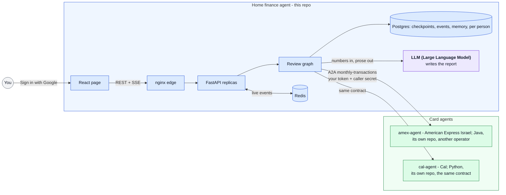

# Architecture

This document details the architecture the [README](../README.md) summarizes. Each section links
the topic document holding the detail, and each founding decision has a record under [adr/](adr/);
how to run the stack is in [Development & deployment](development.md).

**Contents:** [The parts](#the-parts) · [Boundaries](#boundaries) · [Sign-in](#sign-in) ·
[Reviews](#reviews) · [Events and the live stream](#events-and-the-live-stream) ·
[Scaling](#scaling) · [Configuration](#configuration) · [The edge](#the-edge) ·
[Host or guest on EC2](#host-or-guest-on-ec2) · [Storage](#storage) ·
[Codebase structure](#codebase-structure)

The React page talks to the FastAPI backend over REST and a server-sent event stream; the backend
is the A2A client of one card agent per card issuer, all offering the same contract.

## The parts

Each part is a service of `docker-compose.yml`, and the whole stack runs on one machine, a
workstation or an EC2 instance ([ADR 0005](adr/0005-docker-compose-stack.md)). Every route is in
[API endpoints](api.md), the work no request waits on in
[Workers' responsibilities and flows](workers.md).

- `db` — Postgres 16 with the `hfm_pgdata` volume and a `pg_isready` healthcheck.
- `redis` — Redis 7, which carries live review events between the replicas and keeps nothing.
- `migrate` — a one-shot schema migration from the manager image.
- `manager` — two replicas of the backend, from `backend/Dockerfile`: the HTTP API, the event
  stream and the page. It starts after `db` and `redis` are healthy and `migrate` has completed,
  and each replica runs reviews as background tasks in its own process.
- `edge` — nginx, the only service that publishes the agent's port ([The edge](#the-edge)).

## Boundaries

Each card agent normalizes and categorizes its own card, so statement formats and card-specific
labels never reach the home finance agent. They meet at one A2A contract: the skill
`monthly-transactions` takes a billing month and returns rows in one shared format, each placed in a
category by the card agent, an installment or a purchase in another currency being fields of its
row, or a request for the missing statement ([A2A contract](a2a-contract.md)); each card agent is
opaque to this one beyond that contract. Adding a card means running its agent and connecting it
with `tools/add-card-agent.sh`, with no code change here. This agent owns only what spans cards: the
person's categories (which outrank any card agent's), the budget, the totals and the summary. Why
the card agents are separate A2A services is [ADR 0001](adr/0001-a2a-client-of-card-agents.md).

## Sign-in

People sign in with their Google account; there is no other way in. The token is forwarded to each
card agent, which verifies it again, so every agent knows whose data it serves
([ADR 0004](adr/0004-google-sign-in-forwarded-to-card-agents.md)). How it works and how to set up
the Google side are in [Sign-in](sign-in.md).

## Reviews

The [README](../README.md#overview) walks a review as the person sees it. Underneath, a review of
one month runs in the review graph: a small state machine, built with LangGraph, that pauses when it
has a question for the person and resumes with the answer. Its state lives in Postgres, so a
question waits as long as it takes, across restarts; the plan is fixed in code so that no number
comes from the model ([ADR 0002](adr/0002-code-led-review-graph.md)), and a language model gets only
the computed totals and writes the summary. The graph is in [Reviews](architecture/reviews.md), the
runner around it in [Workers' responsibilities and flows](workers.md#reviewrunner-runs), and the
routes the page calls in [API endpoints](api.md#reviews).

## Events and the live stream

Every step of a review is an event appended to a per-review log in Postgres before it is published,
so a subscriber never sees what the log does not hold. The page reads a server-sent event stream
that replays the log and then follows it live, and renders questions, totals and the report from the
latest events alone ([Events and the live stream](architecture/events.md)).

## Scaling

Several replicas of the backend run behind the edge, all on one Postgres and one Redis, and any
replica can serve any request ([ADR 0006](adr/0006-replicas-behind-an-edge.md)). Two concerns
follow: **scaling safety**, that it is safe to run more than one replica without errors; and
**scaling out**, that adding replicas serves more households without degrading anyone's experience
([architecture/scaling.md](architecture/scaling.md)).

## Configuration

Three settings files under `scripts/lib/` carry this agent's own settings, one committed and two
gitignored; the card agents live in a registry per target, and the person's budget in
`config/budget.yaml`. A missing or malformed required setting stops startup rather than
defaulting ([Development & deployment](development.md#configuration)).

## The edge

The edge is the one way into the stack: the nginx `edge` service, which spreads requests over the
manager replicas ([The edge service](architecture/scaling.md#the-edge-service)), and on EC2 a
CloudFront distribution of the stack's own in front of it. `./scripts/deploy.sh --ec2` runs the
same Compose stack on the instance ([The EC2 stack](development.md#the-ec2-stack)).

## Host or guest on EC2

The instance serves the other Docker Compose repos too: one stack is its host, with the instance
its own, and the others join it as guests, each with its own port and CloudFront distribution
([ADR 0007](adr/0007-guest-on-the-loan-simulator-instance.md),
[ADR 0008](adr/0008-any-docker-repo-can-host-the-instance.md)); `EC2_HOST_STACK` chooses which
this stack is ([The EC2 stack](development.md#the-ec2-stack)).

## Storage

One Postgres database (the `db` service, volume `hfm_pgdata`) holds the reviews, their event logs,
LangGraph's checkpoints and two memories per person, the merchants' categories and the reports
already written, in one place to back up and inspect
([ADR 0003](adr/0003-postgres-holds-all-state.md)); [Data model](data-model.md) has every table.

## Codebase structure

The backend package is in layers whose imports point inwards
([Design patterns](design-patterns.md#layers-whose-imports-point-inwards)).

- `backend/` — the Python service: the package `hfm` under `src/`, the Alembic migrations under
  `alembic/`, the tests under `tests/` and the Dockerfile that also builds the page.
- `frontend/` — the React page in TypeScript, built with Vite, its Vitest tests beside the code.
- `nginx/` — the edge's configuration, which Compose bakes into the edge's image.
- `config/` — the budget example; the person's own `budget.yaml` beside it is gitignored.
- `scripts/` — the entry points and `common.sh`, the settings files and the EC2 target under
  `lib/`, the EC2 template, `tools/` and the shell and end-to-end tests under `tests/`.
- `docs/` — this document, the topic documents, `architecture/` for the reviews, the events and
  scaling, the A2A contract's JSON Schemas under `a2a-contract/` and the ADRs under `adr/`.
