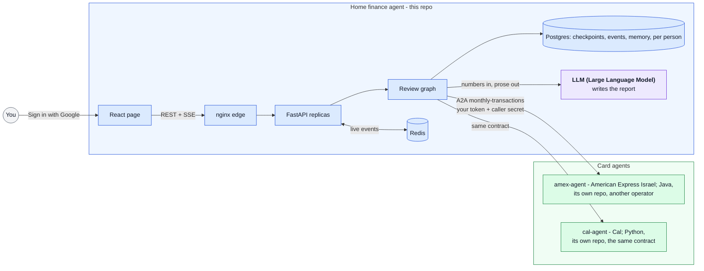

# Architecture

This document details how the home finance agent is built, behind the [README](../README.md)'s
Architecture section. Each section below ends in a page that holds its details. The contract
every card agent offers is in [a2a-contract.md](a2a-contract.md); how each part is tested is in
[testing.md](testing.md); how to run it is in [development.md](development.md). Each founding
decision has an ADR under [adr/](adr/).

**Contents:** [The parts](#the-parts) · [Boundaries](#boundaries) · [Sign-in](#sign-in) ·
[Reviews](#reviews) · [Events and the live stream](#events-and-the-live-stream) ·
[Scaling](#scaling) · [Storage](#storage) · [Configuration](#configuration) ·
[Codebase structure](#codebase-structure)

## The parts

The React page talks to the FastAPI backend over REST and a server-sent event stream, through an
nginx edge that spreads requests over the backend replicas. A review of one month runs in the
review graph: a small state machine, built with LangGraph, that pauses when it has a question for
the person and resumes with the answer. Its state lives in Postgres, so a question waits as long
as it takes, across restarts; the plan is fixed in code so that no number comes from the model
([ADR 0002](adr/0002-code-led-review-graph.md)). The home finance agent is the A2A client of
one card agent per card issuer, all offering the same contract, and each card agent is opaque to
it beyond that contract. A language model gets only the computed totals and writes the summary.

## Boundaries

- **Each card agent normalizes and categorizes its own card, so the home finance agent handles
  nothing card-specific.** Statement formats, card-specific labels, installments and foreign
  purchases never reach it. Rows arrive in one shared format, each placed in a category by the
  card agent with its confidence, `high`, `medium` or `low`, or `uncategorized` when it cannot
  tell. Adding a card means running its agent and connecting it with `tools/add-card-agent.sh`,
  with no code change here. This agent owns only what spans cards: the person's categories
  (which outrank any card agent's), the budget, the totals and the summary.
- **They meet at one A2A contract, the same for every card agent.** The skill
  `monthly-transactions` takes a billing month and returns rows in that shared format (ISO dates,
  amounts in shekels, one category from a closed list), or a request for the missing statement.
  [a2a-contract.md](a2a-contract.md) is the contract; a card agent documents how it implements
  it in its own repo. Why the card agents are separate A2A services is
  [ADR 0001](adr/0001-a2a-client-of-card-agents.md).

## Sign-in

People sign in with their Google account; there is no other way in. The React page keeps the
person's Google ID token in a cookie the backend verifies on every request, and the token is
forwarded to each card agent, which verifies it again, so every agent knows whose data it serves. No
checkpoint ever holds the token. Why sign-in is Google only and forwarded is
[ADR 0004](adr/0004-google-sign-in-forwarded-to-card-agents.md). [sign-in.md](sign-in.md)

## Reviews

The [README](../README.md#overview) walks a review as the person sees it, from the start to the
report. [architecture/reviews.md](architecture/reviews.md) is what runs underneath: the graph, the
runner around it and the HTTP API the page calls.

## Events and the live stream

Every step of a review is an event appended to a per-review log in Postgres before it is
published, so a subscriber never sees what the log does not hold. The page is a server-sent event
stream that replays the log and then follows it live, and renders questions, totals and the report
from the latest events alone. [architecture/events.md](architecture/events.md)

## Scaling

The stack runs on one machine with Docker Compose
([ADR 0005](adr/0005-docker-compose-stack.md)), a workstation or an EC2 instance behind a
CloudFront distribution of its own, which the stack hosts or joins as a guest of another Docker
Compose repo's stack ([ADR 0007](adr/0007-guest-on-the-loan-simulator-instance.md),
[ADR 0008](adr/0008-any-docker-repo-can-host-the-instance.md)): several replicas of the backend
behind an nginx edge, all on one Postgres and one Redis, and any replica can serve any request
([ADR 0006](adr/0006-replicas-behind-an-edge.md)). The concerns that follow are each a GitHub
label beside `scalability`: **scaling safety**, that it is safe to run more than one replica
without errors; and **scaling out**, that adding replicas serves more households without
degrading anyone's experience.
[architecture/scaling.md](architecture/scaling.md)

## Storage

One Postgres database holds the reviews, their event logs, LangGraph's checkpoints and two memories
per person: the categories they chose for merchants, which outrank any card agent's in later
reviews, and the reports already written, so the same totals cost no second model call. One
database keeps every review's state in one place to back up and inspect
([ADR 0003](adr/0003-postgres-holds-all-state.md)).
[architecture/storage.md](architecture/storage.md)

## Configuration

Three settings files under `scripts/lib/` carry this agent's own settings, one committed and two
gitignored; the card agents live in a registry per target, `backend/card-agents.yaml` here and
`backend/card-agents.ec2.yaml` on the EC2 instance, written by a tool, and the person's budget in
`config/budget.yaml`, started from a committed example. A missing or malformed required setting
stops startup rather than defaulting.
[architecture/configuration.md](architecture/configuration.md)

## Codebase structure

- `backend/` — the Python service: the package `hfm` under `src/` in layers with imports
  pointing inwards only, enforced by import-linter
  ([architecture/codebase-structure.md](architecture/codebase-structure.md)); the Alembic
  migrations under `alembic/`; the tests under `tests/`; the Dockerfile that also builds the page.
- `frontend/` — the React page in TypeScript, built with Vite, with its Vitest tests beside the
  components under `src/`.
- `nginx/` — the edge's configuration, which Compose bakes into the edge's image.
- `config/` — the committed budget example; the person's own `budget.yaml` beside it is
  gitignored.
- `scripts/` — the entry points, their shared `common.sh`, the settings files and the EC2
  target under `lib/`, the EC2 template, the hands-on tools under `tools/` and the shell and
  end-to-end tests under `tests/`.
- `docs/` — this document, its sub-pages under `architecture/`, the topic documents, the A2A
  contract's JSON Schemas under `a2a-contract/` and the ADRs under `adr/`.
