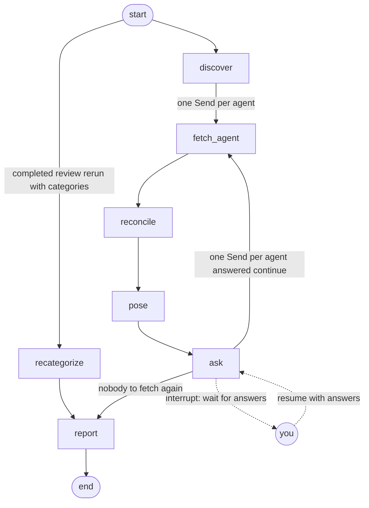

# Reviews

How one review runs: the LangGraph graph that does the work, the runner around it that owns
status, limits and answers, and the HTTP API the page calls. The stream the page renders from is
in [events.md](events.md).

## The graph

`application/review_graph.py` builds the review as a LangGraph state machine whose state is saved
after every step. The review id is the saved state's thread id, so one id names both the review
row and its graph.

Two loops run through it. The human loop pauses at `ask` until answers arrive, for as long as it
takes. The fetch loop goes back to `fetch_agent` for every agent whose question was answered
"continue", and the review runs `reconcile`, `pose` and `ask` again on the new rows. A completed
review can be run again on the same thread with categories chosen for its merchants: that run
starts at `recategorize` instead of `discover`, so nothing is fetched again.

| Node | Does |
|---|---|
| `discover` | Reads each configured agent's card and checks it is usable; emits `agent.discovered`. An unusable agent fails the review. |
| `fetch_agent` | Streams one agent's month (or continues its waiting task) with `SendStreamingMessage`; emits `agent.status` and `transactions.batch`; records the task and any request for input or sign-in. |
| `reconcile` | Applies merchant memory, which outranks the card agent's category, computes totals, emits `review.totals`. |
| `pose` | Builds the questions (one per merchant with an uncategorized or `low`-confidence row, not left unanswered earlier, one per agent waiting for input), emits `review.question` and stores the questions. |
| `ask` | Calls `interrupt()` with the stored questions; on resume checks the answers, remembers the chosen categories, marks unanswered merchants and skipped agents, and emits `review.totals` again when something changed. |
| `recategorize` | Remembers the categories chosen for merchants of a completed review, applies them to every row of each merchant, and emits `review.totals`. |
| `report` | Builds the prompt from the computed totals and emits `review.report` with the text the person's report memory holds for that exact prompt; for a prompt never narrated for them it emits `review.writing`, asks the model and remembers the text. |

**Reducers.** Parallel fetches write to the same state keys, so each such key has a merge rule:

- `transactions` (`merge_transactions`): one row per (agent, transaction id), the later copy
  winning, first-seen order kept, so rows resent after a "continue" are counted once.
- `infos`, `tasks`, `pending_remote`, `skipped` (`merge_dict`): per-agent entries merged, and a
  `None` value removes the agent's entry, which is how an answered remote question is cleared.

**Why `Send`.** The number of fetches is data, not graph shape: one per configured agent at the
start, then one per agent answered "continue", each carrying its own agent, month and the task to
continue. A conditional edge returning a list of `Send` runs exactly those fetches in parallel,
each with its own input, and the reducers merge their results.

**Why `interrupt()` with a Postgres checkpointer.** A paused review holds no process, thread or
connection; it is a saved state in Postgres, built by LangGraph's `AsyncPostgresSaver`. The
answer may come hours later or after a restart, and the runner resumes the same thread with
`Command(resume={"answers": ...})`.

**Why `pose` and `ask` are separate nodes.** On resume LangGraph runs the interrupted node again
from its first line. If one node emitted `review.question` and then interrupted, every resume would
emit the question again. `pose` emits and saves the questions; `ask` only reads them and
interrupts, so rerunning `ask` emits nothing twice.

**The agent's task states.** `fetch_agent` keys on the A2A task state of every status event, never
on the stream's final flag. `TASK_STATE_SUBMITTED` and `TASK_STATE_WORKING` are passed on as
`agent.status` and nothing more. `TASK_STATE_INPUT_REQUIRED` means the agent waits for the person:
its text, its reason (`statement-missing` for a statement not loaded yet) and the page it names
become a remote question, below. `TASK_STATE_AUTH_REQUIRED` means the person's token was missing,
bad or expired; its reason must be `sign-in-required`, and it becomes a remote question whose only
action is "continue": the page shows the Google button inline, and the continue forwards the fresh
token ([sign-in.md](../sign-in.md)). `TASK_STATE_COMPLETED` records the task. `TASK_STATE_FAILED`,
`TASK_STATE_CANCELED` and `TASK_STATE_REJECTED` fail the review with the agent's text, as does a
stream that ends in none of these or a pause with no text for the person.

**What "continue" and "skip" mean.** A remote question comes from an agent whose task is waiting for
the person, most often for a statement not loaded yet. "continue" sends `{"action": "continue"}` on
that same A2A task, so the agent picks the request up where it paused; if the statement is still
missing, the agent asks again. When the agent names a page for the request, the question carries
`link`, that page on the agent's browser address (`AgentConfig.browser_url`), where the person loads
the statement and then continues. A statement question also offers "skip", which leaves the agent
out: the review totals what it has, lists the agent under `skipped` in `review.totals`, and the
report prompt asks the model to say plainly that the agent's spend is missing. A mid-month review
needs it: the month's statement does not exist yet, so "continue" would only be asked again, and
"Include expected charges" then projects the skipped agent's recurring charges.

**Checkpoint types.** `checkpoint_serde()` gives the checkpointer an explicit allow-list of the
domain types that can sit in the state (`CHECKPOINTED_TYPES`). LangGraph rebuilds only those types
and its own safe built-ins from a checkpoint; any other type is not rebuilt, and LangGraph logs a
warning. `LANGGRAPH_STRICT_MSGPACK=true`, which the scripts, compose and the test suite set, puts
LangGraph's default serializers in the same strict mode instead of their permissive default. The
graph tests fail on any checkpoint warning, so a state type missing from the list fails the suite.

**No secret in a checkpoint.** The state and every `Send` name agents only; `discover` records the
configured names when the review starts, and each fetch resolves the name to its URL and token from
the graph's dependencies. A paused review whose agent has left the registry
`backend/card-agents.yaml` fails with "`<name>` is no longer configured" when it resumes.

**Numbers never come from the model.** Totals, limits and the over-budget flag are computed in
`application/reconcile.py` with `Decimal`. The model only receives them as a table in the prompt
(`application/report.py`) and returns prose, which is shown as is.

## The run

`platform/review_runner.py` owns the graph invocations, each on behalf of the signed-in person.
Every invocation runs as a background task, so the HTTP request that starts or answers a review
returns as soon as the review is recorded. A review has at most one invocation in flight. A review
that belongs to someone else is not found, exactly like one that does not exist, so no id reveals
another person's review; each person has their own standing review per month and their own starts
within the daily limit (below).

| Status | Means |
|---|---|
| `running` | An invocation is in flight. |
| `waiting` | The graph stopped at the `ask` interrupt. |
| `completed` | The graph reached its end. |
| `failed` | The invocation raised; a `review.failed` event carries the message. |

**The transitions.** A start creates the review `running`. The invocation ends it `waiting` at the
`ask` interrupt, `completed` at the graph's end, or `failed` when it raises. An answer takes a
`waiting` review back to `running`, and chosen categories take a `completed` one back to `running`,
to end `completed` again; nothing moves a `failed` review on. Every transition after the start is
also an event in the review's log, next. Clearing is not a status: any review not `running` may be
cleared, which hides it from the API while its row stays (below).

**Every status change is an event.** Except for the `running` status a new review starts with,
each status is written in the same transaction as an event in the review's log: `review.status`
names the new status, and `review.failed` sets `failed`. `waiting` and `completed` are written only
after the invocation's last checkpoint. The page takes the review's status from these events, so by
the time it shows a question or a completed review, the database already holds that status for
every replica, and an answer or a request for the expected charges sent straight away is accepted.

**A restart keeps waiting reviews and fails running ones.** A `waiting` review is only a saved
state, so it can be answered after any restart; a review still `running` when the server starts lost
its invocation with the old process, so startup marks it `failed` with the `review.failed` message
"interrupted by a server restart; clear the review and start it again". The sweep runs in every
process that starts against the database, whoever runs the review.

**Starts are rationed.** Every start fetches the month from the card agents, which classify its
merchants with a model, and has a model write the report unless the person's report memory holds the
text for the very same totals, so repeating a start costs model calls on both sides. A month
therefore holds one standing review until the person clears it (`DELETE /api/reviews/{id}`); a start
for a month that has one is refused with 409 naming it. The page asks first (`GET
/api/months/{month}`), so it never offers that start: a month with its review shows the review and
offers Clear review, a month without one offers Start review with the starts left. A running review
cannot be cleared, since its invocation would go on writing to it. On top of that, at most
`DAILY_REVIEW_LIMIT` (5) reviews start in any 24 hours (`REVIEW_LIMIT_WINDOW`), cleared ones
included, and a start past it gets 429 with `Retry-After`. A cleared review is kept in the database
with `cleared_at` set, so it still counts, but the API answers 404 for it. A partial unique index on
`reviews` (`user_id`, `month`) where `cleared_at` is null holds the one-standing-review rule in the
database too; the runner checks both rules under the lock that serializes its status changes.

**Answers are checked before the graph resumes.** The runner validates an answer set against the
saved questions first: every remote question answered, no unknown id, every value one of the offered
options. Categorize questions may go unanswered, since a person may not recall every merchant: those
rows keep the card agent's category (`uncategorized` when it had none), nothing is remembered for
them, and the review does not ask about them again, even after a "continue" brings more of their
rows. A bad set gets HTTP 422 with the `missing`, `unknown` and `invalid` ids, and the review stays
paused. The check has to happen here, not inside the graph: LangGraph keeps the resume value of a
failed run and replays it on every later resume of the thread, so one bad answer set would break the
review for good.

**Answers that race the pause.** `pose` emits `review.question` before `ask` saves the pause, so a
client that answers as soon as that event arrives may do so while the run is still settling. The
replica running the review then waits up to 30 seconds (`SETTLE_SECONDS`) for the run to stop
instead of refusing with 409. The review view (`GET /api/reviews/{id}`) offers questions only once
the status is `waiting`.

**Failures are readable.** A `ReviewError` (an unusable agent, an agent's failed task, a review
with no agents) reaches the user verbatim in `review.failed`. Any other error is reported as
`<Type>: see the server log` and logged with its traceback.

## HTTP API

| Route | Answer |
|---|---|
| `POST /api/reviews` `{"month": "YYYY-MM"}` | 202 `{"id": ...}`; 409 with `detail` `{"message", "reviewId"}` when the month has a standing review; 422 for a malformed month; 429 with `Retry-After` past the daily limit. |
| `GET /api/reviews/{id}` | Month, status, `createdAt`, open questions, totals, skipped agents, report; 404 for an unknown or cleared id. |
| `GET /api/months/{month}` | 200 `{"month", "review": {"id", "status"} or null, "limit", "startsLeft", "nextStart"}`: the month's standing review and whether a review may start now; `nextStart` is null while starts are left; 422 for a malformed month. |
| `DELETE /api/reviews/{id}` | 204, and the review is cleared, freeing its month; 404 unknown or cleared review; 409 running. |
| `POST /api/reviews/{id}/answers` `{"answers": {question id: value}}` | 204; 404 unknown review; 409 not waiting; 422 invalid answer set. |
| `POST /api/reviews/{id}/categories` `{"categories": {merchant key: category}}` | 204, and the review reruns from `recategorize`; 404 unknown review; 409 not completed; 422 no categories, a merchant not in the review or an illegal category. |
| `GET /api/reviews/{id}/expected` | 200 `{"basedOn", "transactions", "categories", "chosen", "totals", "standingOrders"}`: the charges the review's month still expects, projected from the person's latest completed, uncleared review of an earlier month (`basedOn`, null when there is none), their `categories` and `chosen` shaped as in `review.totals` so the page marks them as it marks charged rows, with the totals and standing-order spend they add up to; reads saved reviews only, reaching no card agent; 404 unknown review; 409 not completed. |
| `GET /api/reviews/{id}/events` | The live event stream (below). |
| `GET /health`, `GET /ready` | Process up; process up and the database answers `SELECT 1` (503 otherwise). |

Money in the API and in events is a decimal string with two places (`domain/events.py` `money_text`:
`"86.90"`, `"800.00"`); totals are computed on the exact `Decimal` values first. The report prompt,
like the page, shows whole amounts with thousands separators (`3,537`), so the summary quotes them
that way. A transaction's `originalAmount`, in a foreign currency whose minor unit may differ, is
written as the agent sent it.
