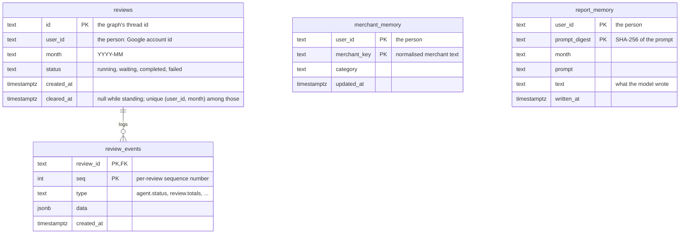
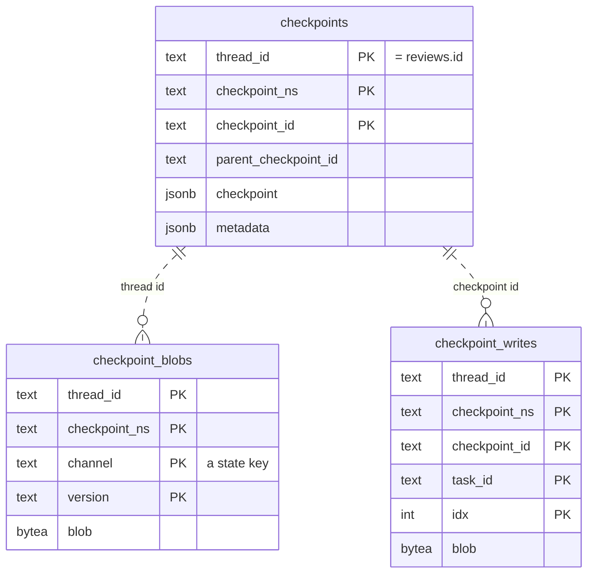

# Storage

One Postgres database (`postgres:16` in compose, published on `127.0.0.1:5434`) holds two groups
of tables: this agent's own, and LangGraph's checkpoints.

## This agent's tables

Created by the Alembic migrations in `backend/alembic/versions/`, which also move remembered
categories onto the current category list. Only `review_events` has a foreign key: a review's
events, keyed by the review id and a per-review sequence number. The two memories belong **to a
person**, not to a review: they are keyed by **`user_id`**, which every table here carries, so each
person's data is kept apart by the same column everywhere. `reviews` keeps one standing review
per person and month (the partial unique index on `cleared_at IS NULL`).

## LangGraph's checkpoints

The checkpointer's own schema, the same in any LangGraph app on Postgres. The tables are created,
or brought to the installed library's version, by the saver's own setup at the end of every
migration run (`backend/alembic/env.py`), never by the app. This agent's one convention is that
`thread_id` is the review id, so a review's saved state is found by `reviews.id` without a foreign
key, and the review's owner is the `reviews` row's `user_id`.

## The two memories

A person's merchant memory is shared by all their reviews and kept until changed, so a second
review of the same month asks nothing; the end-to-end test therefore runs on a fresh database. A
person's report memory holds each report prompt of their recent reviews with the text it got. The
prompt is everything the model sees, so a review whose totals, skipped agents and transaction
count match a remembered one, a repeated start of the month or a category change undone, shows
that text without a model call, and a prompt not held, a changed number or changed wording in
code, has the model write a text that is remembered beside the others. A row is written once and
never changed, since it can describe no other facts than its prompt holds. Writing a person's
report forgets their rows older than `REPORT_MEMORY_RETENTION_DAYS`, so reading costs no write
and the rows a person keeps are those of the window.

The merchant key is the normalised merchant text (`domain/merchants.py`): lower case, spaces
collapsed, company suffixes and trailing number groups dropped. The rule is the home finance
agent's own; no card agent needs to share it.

## Connections

The checkpointer and the repositories each draw connections from a pool that tests a connection
before handing it out, so a database restart fails only the requests in flight at that moment;
the home finance agent itself needs no restart.
