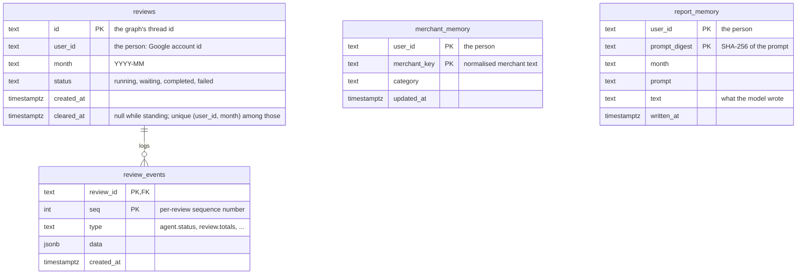
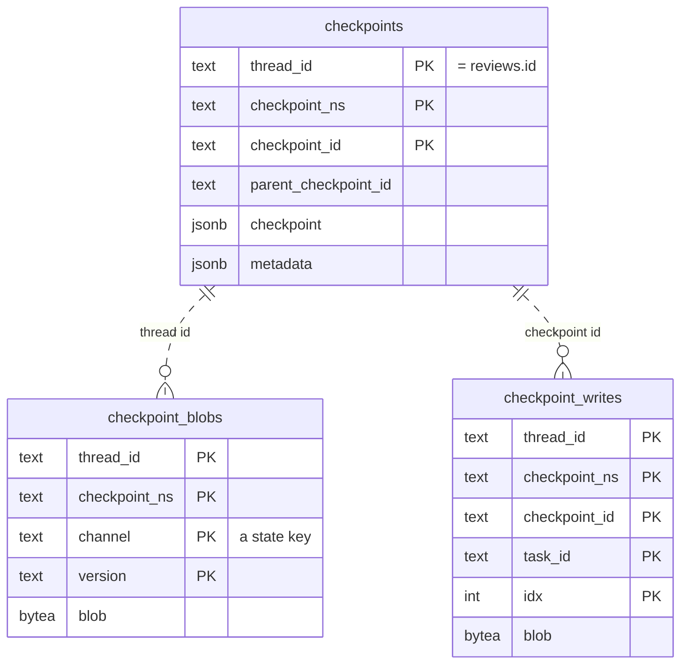

# Storage

One Postgres database holds everything the home finance agent keeps: its own tables, and
LangGraph's checkpoints of each review's graph. Reviews and both memories carry the person's
Google account id, and events and checkpoints hang off a review, so each person's data is kept
apart by that one id.

## This agent's tables

The migrations create these tables and move remembered categories onto the current category
list. A review's events are keyed by the review and a per-review sequence number. The two memories
belong to a person, not to a review, so they outlive the review that wrote them. A unique index
keeps one standing review per person and month.

## LangGraph's checkpoints

This is LangGraph's own schema, the same in any LangGraph app on Postgres. The migration run creates
it, never the agent at startup, so replicas booting together do not race to create it. The thread
id is the review id, so a review's saved state, and through the review row its owner, is found
without a foreign key.

## The two memories

**Merchant memory** holds the category a person chose for a merchant, and it outranks any card
agent's category in every later review. A second review of the same month therefore asks nothing,
which is why the end-to-end test needs a fresh database. Merchants are matched by a key of the
home finance agent's own: the merchant text in lower case, without company suffixes or trailing
numbers, so no card agent has to share the rule.

**Report memory** holds each report prompt of a person's recent reviews with the text the model
wrote for it. The prompt is everything the model sees, so a review with the same totals, such as a
repeated start or a category change undone, shows the remembered text without a model call. A
changed number or a changed prompt in code gets a new text. Rows older than the retention period
are forgotten when the person's next report is written.

**Connections** are checked before use, so a database restart fails only the requests in flight
at that moment and the agent itself needs no restart.
