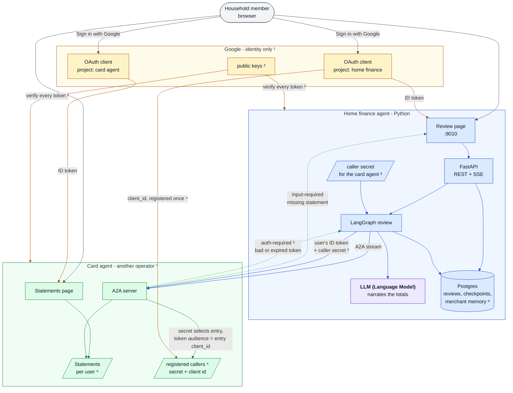

# Sign-in across agents

People sign in to the home finance agent and to the card agents it calls with their Google account,
and there is no other way in. Every piece of data belongs to the person who signed in. The two sides
trust each other through one explicit step: the home finance agent is registered with each card
agent as a caller. "The card agent" below is any card agent the home finance agent calls; the demo
has one, amex-agent. This page explains how that works and how to set up the Google side; the
message details are in [a2a-contract.md](a2a-contract.md).

**Contents:** [The design in six points](#the-design-in-six-points) ·
[Setting up Google](#setting-up-google) ·
[What a real card issuer would do differently](#what-a-real-card-issuer-would-do-differently) ·
[Where it lives in the code](#where-it-lives-in-the-code)

In the diagram, colors mark who owns a component and who sends an arrow: blue for the home finance
agent, green for the card agent, amber for Google, violet for the language model, grey for the
person at the browser. The superscripts ¹ to ⁶ mark the six points below the diagram; ⁷ marks [what
a real card issuer would do differently](#what-a-real-card-issuer-would-do-differently).

## The design in six points

**¹ Google is the only identity.** Each agent has its own OAuth client in its own Google Cloud
project, so the two share nothing by default; two projects under one Google account stand in for two
operators. A person signs in to each page with the same Google account. The stable Google account id
is the user id in both agents. No registration step, no stored passwords.

**² Every token is verified locally, the same way everywhere.** Both agents fetch and cache the
public keys Google publishes and check each token's signature, issuer, expiry and audience. The
audience names the client the token was issued to; a page accepts only its own client id. A Google
ID token lives about an hour; when it expires, the next request answers 401 and that agent's page
shows the sign-in button again. There are no refresh tokens and no server-side sessions.

**³ An A2A call carries two things.** The shared secret, under the header `X-Caller-Secret`, proves
the request comes from the home finance agent. The signed-in person's Google ID token, forwarded
as received in `Authorization: Bearer`, says which person the call is for, and the card agent
verifies it itself rather than trust a bare user id.

**⁴ The card agent registers callers in config of its own, not in a database.** One entry per
caller: a name, the secret the card agent issued to it, and the Google client id of the caller's own
sign-in. The secret on a request selects the entry; the forwarded token's audience must equal that
entry's client id. Registration is the card agent's operator running its registration script, which
issues the secret; removing the entry revokes the caller. Only the secret is confidential; the
client id is public. The hand-over to this side, and `add-card-agent.sh` recording it, is in
[connecting-agents.md](connecting-agents.md). The agent card advertises both schemes.

**⁵ A missing, bad or expired token** is answered with the A2A auth-required task state. The home
finance agent treats it as one more pause: the review waits on a "sign in again and continue"
question, the review page shows the Google button inline, and the continue forwards the fresh token.

**⁶ Data is keyed by user.** In the home finance agent: reviews, review events, checkpoints,
merchant memory, and the live event stream, where a person may subscribe only to their own review.
The card agent keeps its statements per user too, and a missing-statement link lands the same person
on its page.

## Setting up Google

Give each agent its own Google Cloud project with one OAuth client, rather than two clients in one
project. Both work technically: a client id is what an agent verifies, and two clients in one
project are as distinct as two in separate projects. Two projects is still the right choice,
because it is the shape of the real deployment, where the card agent belongs to another operator:
each project has its own consent screen, test users and owner, and nothing in one console touches
the other. One project would make the two agents look like one app, which is what this demo
exists to show they are not. The steps are this agent's; a card agent's own docs give its origin
and setting.

1. **Create the project.** In the [Google Cloud console](https://console.cloud.google.com/), open
   the project picker at the top of the page, choose **New project**, name it
   `home-finance-agent` and create it. Make sure the picker now shows that project:
   everything below is per project.
2. **Configure the consent screen.** Search the top bar for **Google Auth Platform** and open it
   (older consoles reach the same place as **APIs & Services → OAuth consent screen**). A new
   project shows "Google Auth Platform not configured yet" with a **Get started** button. The
   wizard asks for an app name (the agent's name) and your email as the support email, then the
   audience, where you choose **External**, then a contact email, then your agreement to Google's
   policy. **Create** finishes it. The app is now in **Testing**, which is where it stays: no
   verification, no publishing.
3. **Add the test users.** Open **Audience** and, under **Test users**, add the household's
   Google accounts. While an app is in testing, Google signs in nobody else, with an "access
   blocked" page. **Data Access** stays empty: the agent needs no scope beyond the defaults.
4. **Create the client.** Open **Clients → Create client**, choose **Web application**, give it a
   name, and under **Authorized JavaScript origins** add `http://localhost:8010`. Leave
   **Authorized redirect URIs**
   empty: the sign-in button hands the token to the page directly. **Create** shows the client id,
   a long string ending in `.apps.googleusercontent.com`, next to a client secret and a JSON
   download. Only the client id is needed; it stays listed on the Clients page. Ignore the secret
   and the download, close the dialog, and the "shown once" warning costs nothing: the agent
   verifies tokens, it never redeems codes, so nothing in this repo has a place for the secret.
5. **Give it to the agent.** Copy the client id into `GOOGLE_CLIENT_ID` in `backend/.env`, the
   file `init-env.sh` wrote.

Then `start.sh`; connecting a card agent is in [connecting-agents.md](connecting-agents.md).

Google accepts only `localhost` or a public hostname as an authorized origin, never a private
address such as `10.0.0.23`, so a phone on the same network cannot sign in until the stack is
reached through a hostname.

## What a real card issuer would do differently

The card agent accepts a Google token that was issued to the home finance agent's app. A real card
issuer would not: that token proves to the home finance agent who the person is, and says nothing
about whether the issuer knows them. The issuer would have the person sign in at its own site, issue
a token of its own, and let the home finance agent act for the person with that token.

The demo skips this because one household runs both agents. The caller secret and the client-id
check in the caller registry already decide who may call and for which app's users, which is the
guarantee that matters at this scale. Everything else in this document would stay as it is.

## Where it lives in the code

- **Token verification** is one adapter behind a port, used for the page's cookie and nowhere else;
  tests swap Google's keys for their own through a setting.
- **The session** is the verified Google ID token in an HttpOnly, SameSite=Strict cookie, checked
  again on every request. A cookie rather than a header, because the browser's event-stream object
  cannot send headers. Nothing is stored server side.
- **The person's token reaches the card-agent call** through a context variable the runner sets
  around each graph run, never through the graph state, so no checkpoint holds it. A test searches
  every stored checkpoint for it.
- **The A2A client** sends the bearer token and the caller secret on every call, and turns the
  auth-required state into a "sign in again and continue" question.
